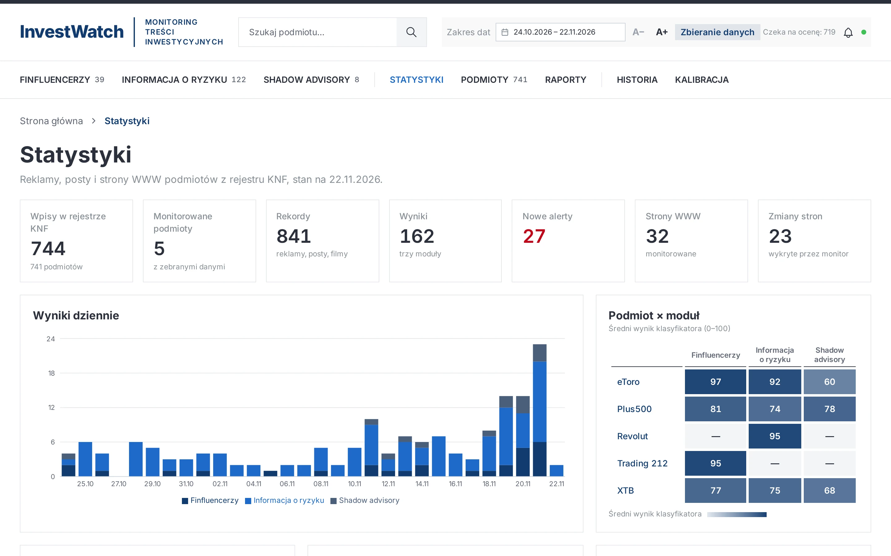
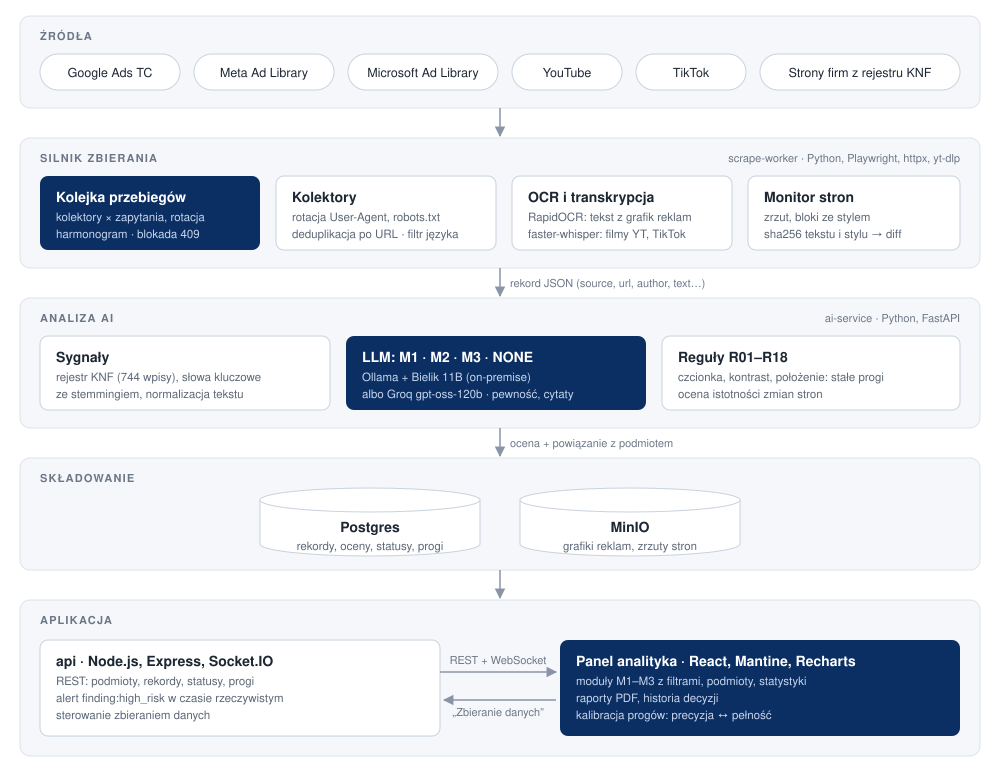
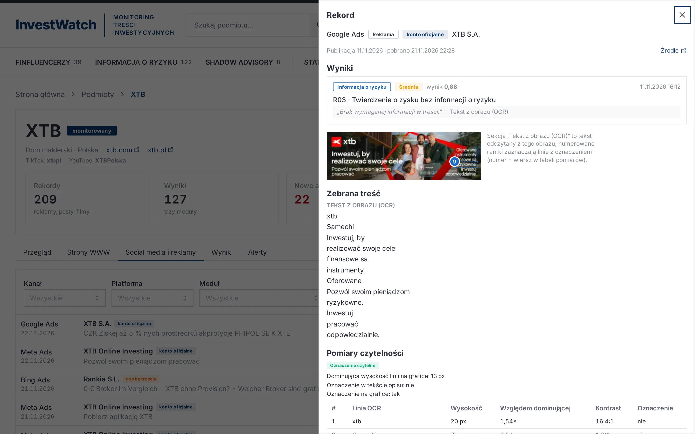
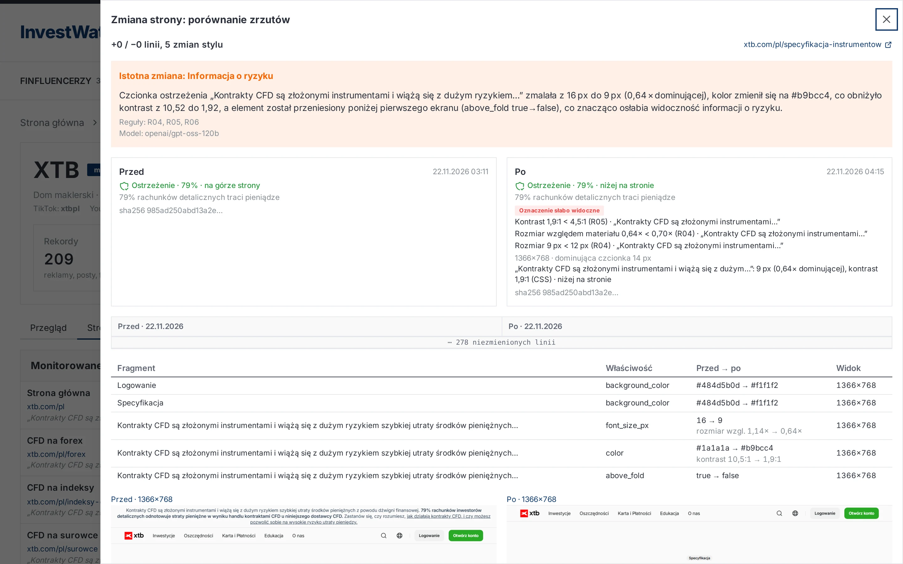
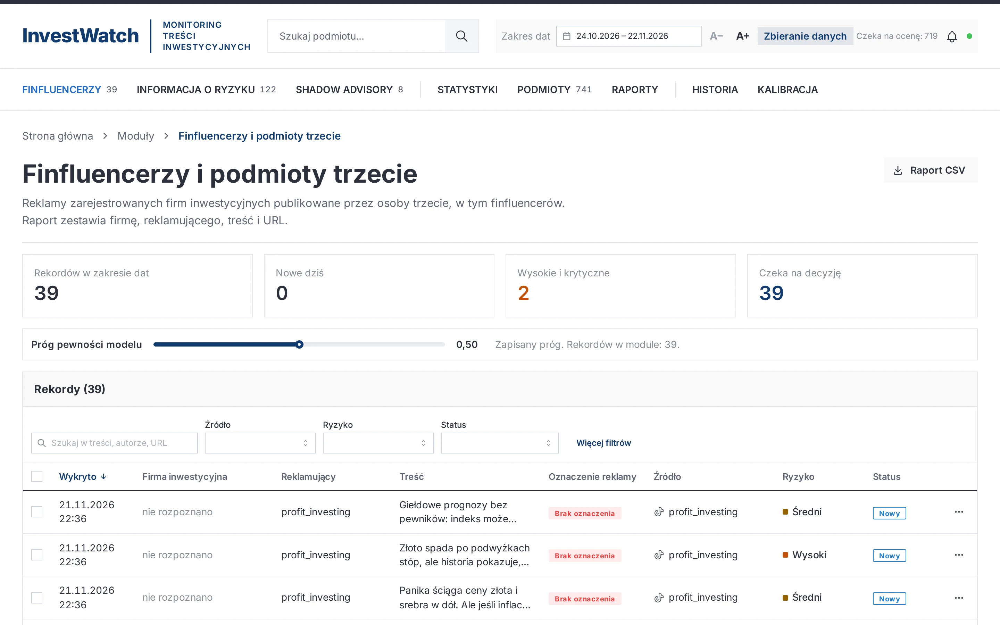
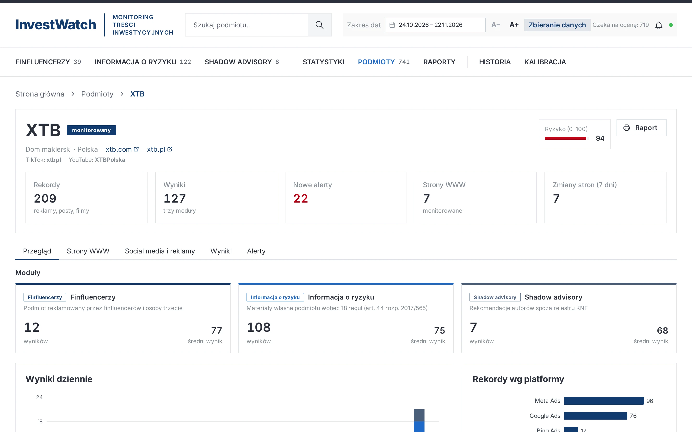
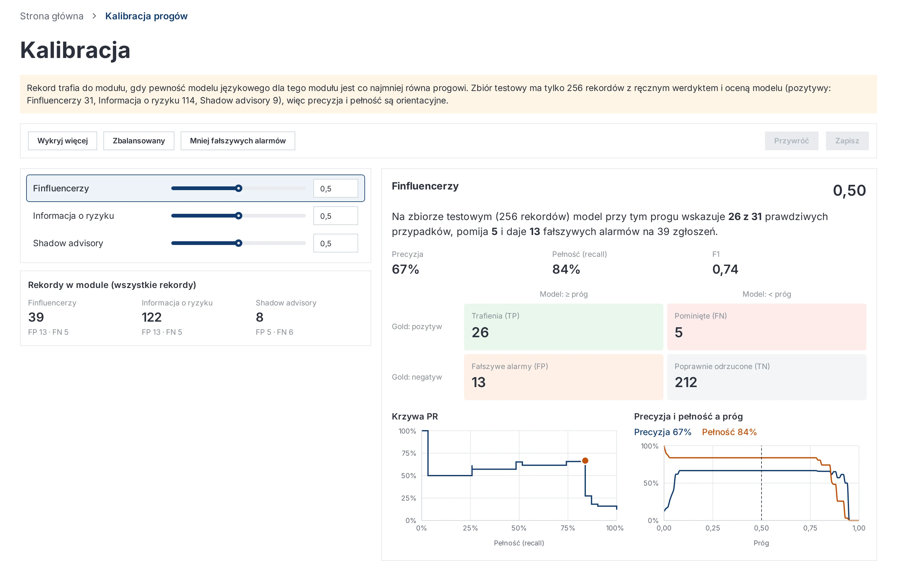
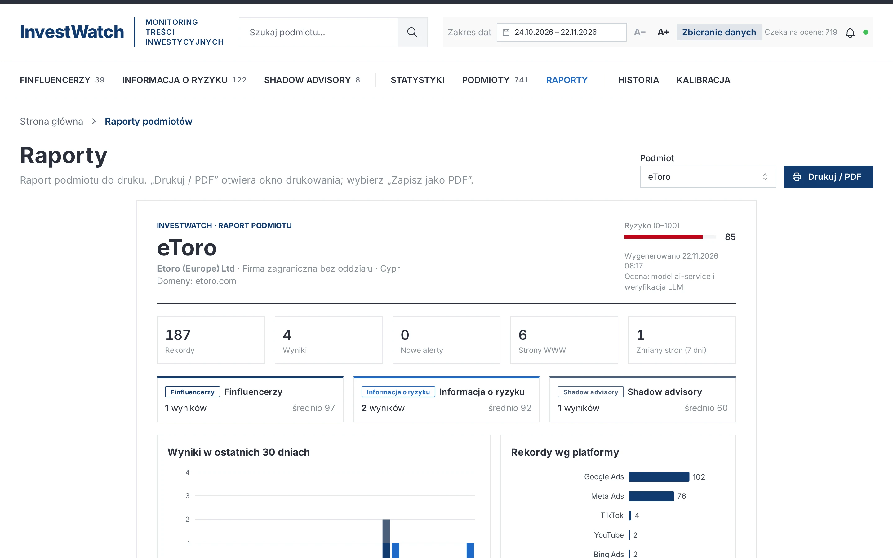

# InvestWatch

System monitoringu treści inwestycyjnych dla UKNF. Zbiera reklamy, posty, filmy i strony WWW firm z rejestru KNF, ocenia je modelem językowym i regułami, a analitykowi wskazuje materiały do weryfikacji razem z dowodem.



| Moduł | Szuka | Wynik dla analityka |
|---|---|---|
| **M1 Finfluencerzy** | reklam firm inwestycyjnych publikowanych przez osoby trzecie i finfluencerów | firma, reklamujący, treść, URL, oznaczenie współpracy |
| **M2 Informacja o ryzyku** | materiałów samej firmy niezgodnych z 18 regułami (art. 44 rozp. 2017/565) | naruszone reguły, cytat, pomiar czcionki i kontrastu |
| **M3 Shadow advisory** | doradztwa inwestycyjnego od podmiotów spoza rejestru KNF | podmiot, treść oferty, URL |

Wynik to wskazówka dla analityka, a nie rozstrzygnięcie prawne.

## Uruchomienie projektu

Wymagany Docker z Compose.

| Tryb | Komenda | GPU |
|---|---|---|
| **LLM przez API (Groq)** | `docker compose -f compose.yaml -f compose.api.yaml up -d --build` | nie |
| API + przycisk „Zbieranie danych” | `docker compose -f compose.yaml -f compose.api.yaml --profile scraping up -d --build` | nie |
| Zbieranie + tryb filmowy (transkrypcje) | `$env:SCRAPE_VIDEOS=1; docker compose -f compose.yaml -f compose.api.yaml --profile scraping up -d --build` (bash: `SCRAPE_VIDEOS=1 docker compose ...`) albo `SCRAPE_VIDEOS=1` w `.env` | nie |
| **On-premise, Bielik 11B w Ollama** | `docker compose -f compose.yaml -f compose.gpu.yaml --profile local-llm up -d --build` | NVIDIA, testowane na 12 GB VRAM |

Aplikacja: <http://localhost:8080>. Przy każdym `up` usługi `db-init` i `loader` ładują `data/` do Postgresa i MinIO, a nowe rekordy oceniają w tle.

```bash
docker compose run --rm loader     # kolejna porcja ocen LLM
docker compose run --rm db-init    # ponowne wczytanie po nowych plikach w data/
docker compose down -v             # czysty stan
```

### Konfiguracja (`.env`, wzór w `.env.example`)

| Zmienna | Domyślnie | Znaczenie |
|---|---|---|
| `LLM_BACKEND` | `groq` | parametr builda: `groq` \| `ollama` \| `none` (słownik bazowy); po zmianie `--build` |
| `GROQ_API_KEY` | — | klucz Groq dla trybu API |
| `LLM_MODEL` | `openai/gpt-oss-120b` (Groq), `bielik-11b-v3.1` (Ollama) | model oceny |
| `OLLAMA_URL` | `http://ollama:11434` | Ollama na hoście: `http://host.docker.internal:11434` |
| `LOADER_LLM_LIMIT` | `100` | rekordów ocenianych przez LLM w jednym przebiegu |
| `YOUTUBE_API_KEY` | — | opcjonalnie, kolektor YouTube |
| `SCRAPE_VIDEOS` | `0` | tryb filmowy `scrape-worker`: `1` włącza transkrypcję filmów YouTube i TikTok; model Whispera (ok. 500 MB) pobiera się dopiero przy pierwszym przebiegu, nie przy buildzie |
| `VIDEOS_MAX_PER_QUERY` | `3` | w trybie filmowym: filmów YouTube na zapytanie i TikTok na konto |
| `POSTGRES_PASSWORD`, `MINIO_ROOT_PASSWORD` | deweloperskie | zmień poza komputerem deweloperskim |
| `FRONTEND_PORT`, `AI_PORT` | `8080`, `8000` | porty, publikowane tylko na `127.0.0.1` |

## Architektura



| Usługa | Technologia | Rola |
|---|---|---|
| `frontend` | React 18, Mantine 8, Recharts, nginx | panel analityka |
| `api` | Node.js, Express, Socket.IO | REST, statusy, progi, alerty w czasie rzeczywistym, sterowanie zbieraniem |
| `ai-service` | Python, FastAPI | język, rejestr KNF, reguły, LLM, ocena zmian stron |
| `scrape-worker` | Python, Playwright, faster-whisper, RapidOCR | przebiegi kolektorów: ręczne i z harmonogramu |
| `db-init`, `loader` | Python | migracje, rejestr KNF (744 wpisy), ładowanie i ocena rekordów |
| `postgres` | PostgreSQL 16 (pgvector) | baza metadanych i treści |
| `minio` | MinIO | object storage: grafiki reklam, zrzuty stron |
| `ollama` | Ollama | lokalny LLM (profil `local-llm`) |

Każda usługa to osobny katalog i obraz (`frontend/`, `api/`, `ml/`, `scrapers/`, `db/`). Komunikacja tylko przez HTTP w sieci Compose. Kontrakt rekordu: [data/export/README.md](data/export/README.md).

## Przepływ danych

- **Kolejka przebiegów:** `scrape-worker` planuje kolektory × zapytania z rotacją, trzyma kolejkę rekordów czekających na LLM
- **Harmonogram:** wbudowany cron w `scrape-worker` (interwał w minutach, włączany z panelu). Meta tylko ręcznie, bo regulamin dopuszcza automatyzację wyłącznie przez API.
- **Kolektory:** Playwright, httpx, yt-dlp, oficjalne API (YouTube, Microsoft Ad Library). Rotacja User-Agent, `robots.txt` na stronach firm, odrzucanie cookies.
- **Preprocessing:** ekstrakcja tekstu z HTML, normalizacja, deduplikacja po znormalizowanym URL, filtr języka, OCR grafik (RapidOCR), w trybie filmowym (`SCRAPE_VIDEOS=1`) transkrypcja każdego filmu YouTube i TikTok (napisy YouTube, a bez nich faster-whisper; limit `VIDEOS_MAX_PER_QUERY`).

## Moduły analityczne

### Klasyfikacja

LLM dostaje rekord, wpis z rejestru KNF i słowa kluczowe ze stemmingiem. Zwraca rozkład `{M1, M2, M3, NONE}`, pewność, uzasadnienie i cytaty. Moduły się wykluczają; o przypisaniu decyduje próg z panelu kalibracji. Prompt: [`classifier_prompt.md`](ml/src/investwatch_ml/classifier_prompt.md).

Zgodność z ręczną oceną 42 rekordów:

| Model | Trafność |
|---|---|
| gpt-oss-120b (Groq) | 36/42 (86%) |
| gpt-oss-20b (Groq) | 30/42 (71%) |
| Bielik 11B v3.1 (lokalnie, Ollama) | 29/42 (69%) |

### Reguły M2 (art. 44 rozp. 2017/565)

<details>
<summary>18 reguł</summary>

| # | Reguła | # | Reguła |
|---|---|---|---|
| R01 | identyfikacja firmy | R10 | spójność językowa |
| R02 | oznaczenie reklamy | R11 | porównania bez źródła |
| R03 | zysk bez informacji o ryzyku | R12a/b | wyniki historyczne: okres, waluta i koszty |
| R04 | rozmiar czcionki ostrzeżenia | R13 | dominacja wyników historycznych |
| R05 | ekspozycja i kontrast | R14 | ostrzeżenie przy wynikach |
| R06 | ryzyko ukryte w przypisach | R15 | prognozy bez zastrzeżenia |
| R07 | dostępność bez klikania | R16 | informacja podatkowa |
| R08 | responsywność | R17 | sugerowanie aprobaty organu |
| R09 | zrozumiałość | R18 | nadzór KNF jako argument bezpieczeństwa |

</details>

Reguły R04, R05 i R08 liczą się deterministycznie, bez LLM:

| Pomiar | Próg | Źródło |
|---|---|---|
| kontrast tekstu ostrzeżenia | ≥ 4,5:1 (WCAG AA) | CSS strony albo piksele zrzutu lub grafiki |
| rozmiar względem dominującej czcionki | ≥ 0,7× | bloki strony, linie OCR grafiki |
| rozmiar bezwzględny | ≥ 12 px desktop, ≥ 11 px telefon | jw., grafika skalowana do 1080 px |

Oznaczenie na grafice, które nie spełnia progu, to problem (R02, R06). To samo oznaczenie w tekście opisu znosi problem.



### Monitor stron firm

Każdy zrzut zapisuje tekst, bloki ze stylem (czcionka, kolor, tło, położenie) i obraz. Zmiana skrótu tekstu albo stylu tworzy rekord zmiany z diffem linii i listą zmian stylu. LLM ocenia, czy zmiana ma znaczenie dla informacji o ryzyku.



## Panel analityka

| Widok | Co robi |
|---|---|
| Moduły M1–M3 | lista z filtrami (data, źródło, ryzyko, status), próg pewności, eksport CSV |
| Podmioty | 741 podmiotów z rejestru KNF; karta: rekordy, wyniki, strony WWW, alerty |
| Statystyki | wyniki dziennie, podmiot × moduł, źródła, najczęstsze naruszenia |
| Raporty | raport podmiotu do druku i PDF |
| Historia | zmiany statusów z komentarzem analityka |
| Kalibracja | progi modułów, macierz pomyłek, krzywa precyzja–pełność |
| Alerty | Socket.IO: `finding:high_risk`, `finding:new`, `thresholds:updated` |

<table>
<tr>
<td></td>
<td></td>
</tr>
<tr>
<td></td>
<td></td>
</tr>
</table>

Kalibracja: rekord trafia do modułu, gdy pewność LLM dla modułu ≥ próg. Zmiana progu przelicza na zbiorze z ręcznym werdyktem TP, FP, FN i TN, a po zapisie zmienia listy modułów u wszystkich analityków.

## Dane

| Źródło | Rekordy |
|---|---|
| Microsoft/Bing Ad Library | 1322 |
| Meta Ad Library | 802 |
| YouTube (opis + transkrypcja) | 764 + 352 kandydatów M3 |
| Google Ads Transparency Center (OCR grafik) | 440 |
| TikTok (z transkrypcją) | 49 |
| Reddit (polskie subreddity finansowe) | 5343 |
| Strony oszustów z listy CERT PL (kopie z Wayback Machine) | 53 |

- **Etykiety:** lokalny Bielik 11B oznaczył 4329 dokumentów (temat, typ treści, instrumenty, 23 flagi z dowodem).
- **Klasyfikator pomocniczy:** embeddingi `bge-m3` + regresja logistyczna; test na 548 realnych dokumentach: temat makro-F1 0,77 wobec 0,52 dla słownika.

## Struktura repozytorium

```text
frontend/       panel analityka (React)
api/            backend aplikacji (Node.js)
ml/             ai-service: klasyfikacja, reguły, LLM
scrapers/       kolektory i scrape-worker
adapters/       mapowanie wyników kolektorów na rekord
preprocessing/  OCR, pomiary czytelności
monitor/        monitor stron firm
db/             migracje i loader Postgres + MinIO
deploy/         ustawienia środowisk, test wdrożenia
data/           próbki danych ładowane przy starcie
```
